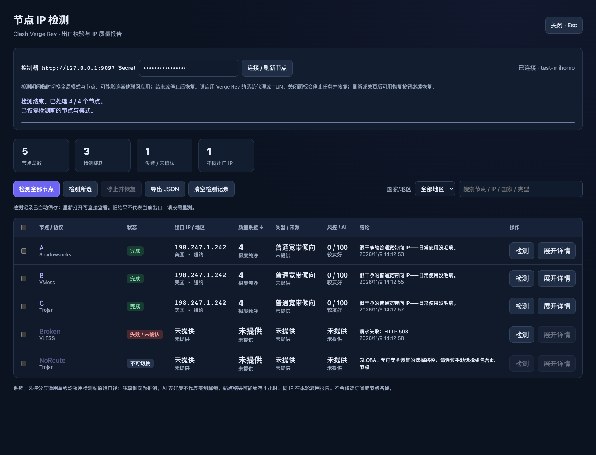
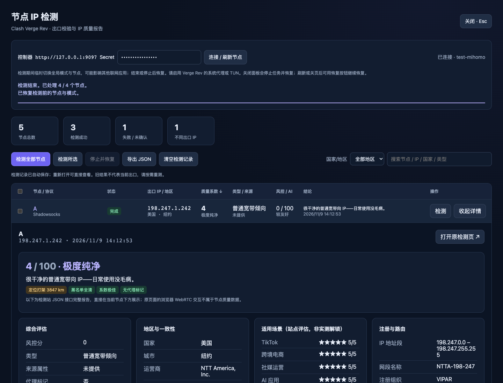

<div align="center">

# 🌐 Clash Verge Rev · 全屏 IP 检测

**油猴用户脚本：逐个切换真实节点出口，校验连接链后查询 IP 质量报告**

[](clash-ipcheck.user.js)
[](clash-ipcheck.user.js)
[](#安装)
[](#开发与测试)
[](LICENSE)

*无需 Python 后端、额外服务，也不修改订阅。*

</div>

---

## ✨ 它解决什么问题

节点列表里的服务器地址往往是**入口、中转或负载均衡 IP**，不是你实际使用的出口。本脚本逐个把流量切到每个节点，同时观察 Clash 连接链确认出口请求确实经过目标节点，再查询该出口 IP 的数据库质量报告——**先确认，再记录**，绝不把直连地址误当作节点出口。

| 面板总览 | 行内详情 |
| :---: | :---: |
|  |  |

## 🚀 安装

1. 在 Chrome / Edge 安装 [Tampermonkey](https://www.tampermonkey.net/) 扩展。
2. 点击扩展图标 → **添加新脚本**，把 [`clash-ipcheck.user.js`](clash-ipcheck.user.js) 全文粘贴进去并保存（或拖入安装）。
3. 打开或刷新 `http://127.0.0.1:9097/`（含 `/ui/` 等面板路径）。
4. 点击右下角 **◉ IP 检测**，填写 Verge Rev 外部控制的 **Secret**（无密钥则留空），点击 **连接 / 刷新节点**。
5. 开启 Verge Rev 的 **系统代理或 TUN**，然后 **检测全部节点** / 勾选后 **检测所选** / 单行 **检测**。

> **关于 Secret**：外部控制接口密钥（Verge Rev 设置中查看），与节点密码不同。脚本只把它发送给本机控制器，不落盘、不发给检测网站。
> 脚本只匹配 `127.0.0.1:9097` 与 `localhost:9097`。检测期间请勿在其他面板切换节点。

## 📋 功能

| 分类 | 说明 |
| --- | --- |
| 🔍 真实出口校验 | 切换节点后观察 Clash 连接链，仅接受经过目标节点的出口查询；无法确认时拒绝记录 |
| 📊 质量报告 | 出口 IP、国家/城市、质量系数与等级、IP 类型、原生/广播、风控分、AI 友好度、一句话结论 |
| ↔️ 排序 | 点击「质量系数」表头切换升序/降序；无分节点排最后，同分保持原序 |
| 🌍 筛选 | 国家/地区下拉（来自检测结果）+ 搜索（节点名 / IP / 国家 / 协议），可叠加 |
| 📂 行内详情 | 点节点名展开/收起，不跳页；可同时展开多个；含数据源对比、RDAP、黑名单、Shodan、原始 JSON |
| 💾 自动保存记录 | 结果存入油猴扩展存储；刷新/重开浏览器直接查看，无需重连或重测；「历史记录」标识旧数据 |
| 🔀 订阅切换 | 换订阅后旧节点记录保留（标记「不在当前订阅」，可查不可测），切回后可继续重测 |
| 🛟 安全恢复 | 检测前保存模式与策略组选择；成功/失败/停止/关面板均自动恢复并核对；崩溃后有恢复按钮 |
| ⏹ 随时停止 | 取消进行中的请求，等待控制器操作结束后恢复原配置 |
| 📤 导出 | 一键导出本轮 JSON（含原始报告与时间），可作记录备份 |

> ⚠️ 每个节点只保留**最新一次**结果；同名节点跨订阅共用记录，请手动重测。「清空检测记录」不影响待恢复的代理配置。

## 🧠 工作方式

```
保存原配置 → 切到目标节点（含策略组内 provider 节点）
    → 经 api.ipify.org 探测出口，同时核对 Clash 连接链
    → 链中含目标节点才接受该 IP
    → 查询 ai01.teleapi.top 报告（同轮同 IP 复用）
    → 恢复原节点与模式，逐组核对
```

- **自动选择组**：能读取 `fixed` 状态时临时固定，结束后还原；老内核无法安全恢复的组会报错而非破坏原选择。
- **负载均衡 / 链式组**：没有单一可固定出口，标记为不可切换。
- **检测站缓存**：站点结果可能缓存约 1 小时，脚本不承诺绕过。

## ❓ FAQ

**查询已知的出口 IP 也要切换吗？**
不需要。只有确认“每个节点的真实出口”才必须让查询经过该节点。

**检测会影响其他应用吗？**
检测期间临时切到全局模式并逐个换节点，可能影响其他应用的联网；结束或停止后自动恢复。

**崩溃 / 断电了怎么恢复？**
重新打开面板，填写 Secret，点 **恢复检测前的节点与模式**。恢复记录存在油猴扩展中（不含密钥），完成恢复前禁止新一轮检测。

**常见报错**

| 现象 | 处理 |
| --- | --- |
| `401` | 检查外部控制 Secret |
| 无法确认出口 | 确认系统代理 / TUN 已接管本脚本浏览器；连接过快结束或其他程序改了选择时会保守拒绝，可单独重试 |
| 自动组缺少 fixed | 改用手动选择组提供路径，避免破坏自动选择 |
| `429` | 检测站限流，脚本自动停止并恢复，稍后重试 |
| 原页与摘要不同 | 站点缓存或查询时刻不同；导出的 JSON 保留本次原始报告 |

## 🛠 开发与测试

```bash
# 用 Playwright + 模拟控制器跑回归（不操作真实 Clash 节点）
../.venv/bin/python tests/smoke.py
```

覆盖：切换顺序（含嵌套策略组）、出口链校验、直连/错误链拒绝、同 IP 缓存、失败与停止后的恢复、崩溃恢复、记录持久化、订阅切换归档、排序/筛选/行内详情、移动端布局与密钥隔离。

> 报告数据字段已与检测站真实公开 JSON 响应核对；本机接口仅做过版本端点可达性检查。

## ⚖️ 免责声明

质量系数、AI 友好度、场景星级均为检测站（[teleapi.top](https://ai01.teleapi.top/ipcheck/)）的评估口径，不代表实测解锁结果；「独享倾向」是推测而非共享人数。出口以访问 `api.ipify.org` 时的观测为准，不承诺所有目标网站、双栈或不同会话完全一致。请遵守当地法律法规，仅用于自有节点的质量检查。

## 📄 License

[MIT](LICENSE)
